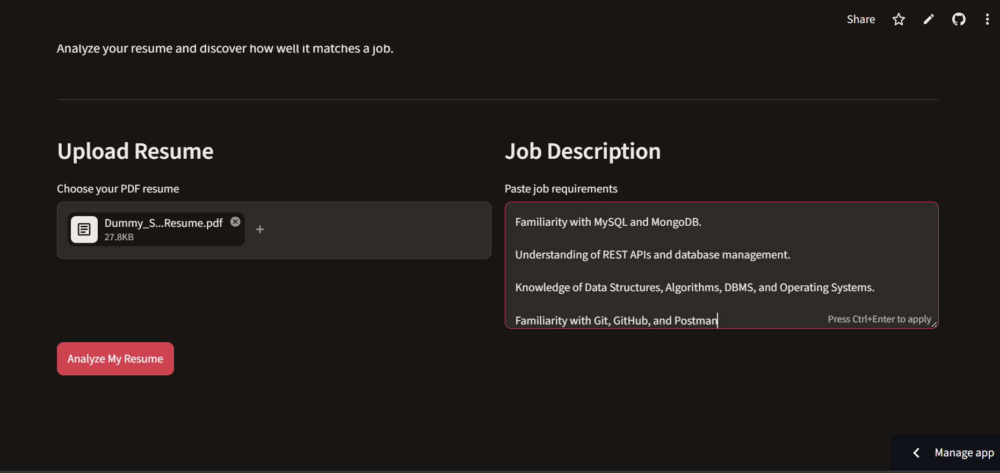
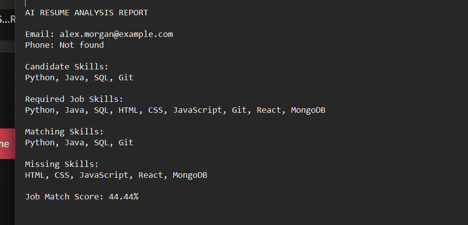

# AI Resume Analyzer

A web app that extracts details from PDF resumes and compares the candidate's skills with a job description.

🔗 **Live demo:** https://ai-resume-analyzer-c64arjt8rc8wf5nhxgnbuf.streamlit.app/

## Screenshots

### Upload


### Skills Analysis


### Analysed Dashboard


### Resume Strength Check


### Downloadable Report


## Features

- Upload PDF resumes
- Extract email and phone number
- Identify skills from the resume (regex-based)
- Compare resume skills with a job description
- Calculate a skill match percentage
- Show matching and missing skills
- Download an analysis report

## Tech Stack

Python · Streamlit · PyMuPDF · Regular Expressions

## Run Locally

```bash
git clone https://github.com/premsangam5/AI-Resume-Analyzer.git
cd AI-Resume-Analyzer
pip install -r requirements.txt
streamlit run app.py
```

## Future Improvements

- Support DOCX resumes
- Improve matching with TF-IDF / NLP techniques
- Suggest skills to add based on the job description

## Author

Prem Sangam — [GitHub](https://github.com/premsangam5) · [LinkedIn](https://linkedin.com/in/prem-sangam)
